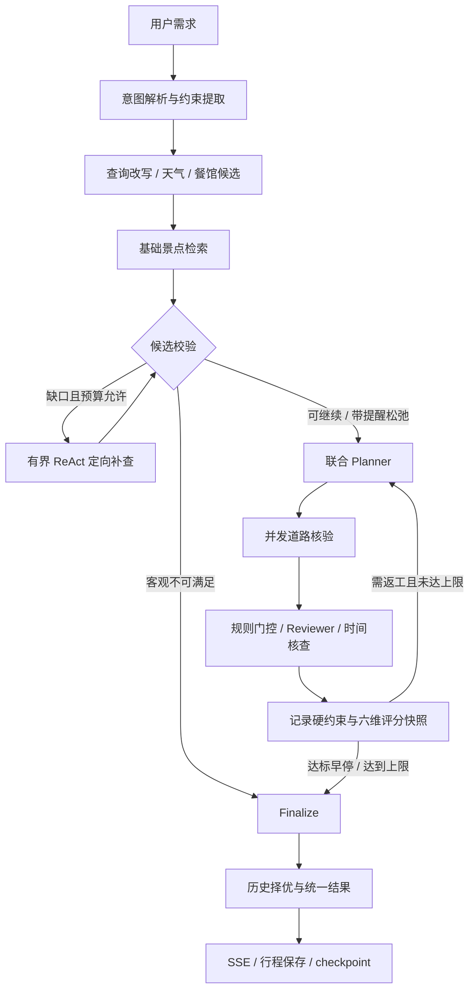

<div align="center">

# TravelMind · 途见

**支持长期记忆与局部修改的多 Agent 旅行规划系统**

[](https://github.com/yf-922/TravelMind-Agent/actions/workflows/ci.yml)


[功能与设计](#功能与设计) · [规划流程](#规划流程) · [快速开始](#快速开始) · [验证与评测](#验证与评测) · [代码与文档](#代码与文档)

</div>


把自然语言需求转为包含景点、餐饮、天气和交通的每日行程，再通过对话继续修改。

> 南京两日游，喜欢历史文化，慢节奏，避开商业街。<br>
> 修改：第二天下午换成室内景点，其他安排尽量保留。

## 功能与设计

| 能力 | 实现方式 |
| :--- | :--- |
| **真实候选池** | 高德 POI 核验与非文旅数据过滤；有界 ReAct 按点名、室内和数量缺口定向补查，查询去重并受轮次 / HTTP 预算限制 |
| **联合规划** | LangGraph + Pydantic State 编排检索、景点与餐饮排期、并发道路核验及审核 |
| **质量闭环** | 确定性规则检查硬约束，LLM Reviewer 判断偏好等软约束；最多返工 3 次，保存最多 4 版快照并择优返回 |
| **局部修改** | 应用层 checkpoint 复用需求、天气与候选；缓存池不足时补查，不默认全量重跑 |
| **长期记忆** | SQLite 保存结构化偏好与行程，Chroma 按用户隔离召回语义记忆；当前明确需求优先 |
| **可见的执行过程** | SSE 返回节点进度、最终路线、提醒及结构化失败原因 |

**结果不只分“通过 / 不通过”**：L0 检查候选合法性、必去覆盖等底线；L1 检查开放时间（含星期闭馆）、时间轴、用户总时间窗及通勤等可执行性。优先返回 L0/L1 均通过的版本；只有 L0 通过时返回 `PARTIAL_SUCCESS` 并保留具体提醒；无 L0 合格版本则返回 `FAILED`、空 `days` 和失败原因。

<details>
<summary>查看行程界面</summary>


</details>

## 规划流程



图中合并了并行分支与餐饮 / 贴士整理。实际节点和条件边见 [graph.py](app/planning/graph.py)。ReAct 提出结构化动作，代码负责工具执行、候选入池和终止条件；不是让模型任意指定下一个节点。

| 最终状态 | 含义 |
| :--- | :--- |
| `SUCCESS` | L0/L1 通过，无提醒 |
| `SUCCESS_WITH_WARNINGS` | L0/L1 通过，带松弛或审核提醒 |
| `PARTIAL_SUCCESS` | L0 通过，仍有 L1 问题；保留路线并明确提示 |
| `FAILED` | 无 L0 合格路线或前置不可满足；`plan.days=[]`，返回 `failure_reasons` |

## 快速开始

### Docker Compose

需要 Docker Compose **v2.24+**。

```bash
git clone https://github.com/yf-922/TravelMind-Agent.git
cd TravelMind-Agent
cp .env.example .env.local
# 填写 .env.local 中的高德与模型配置
docker compose up --build -d
```

Windows PowerShell 复制配置使用 `Copy-Item .env.example .env.local`。

### 本地 Python

推荐 Python **3.11 / 3.12**；前端由 FastAPI 直接提供，无需单独构建。

```bash
python -m venv .venv
# Linux / macOS
source .venv/bin/activate
# Windows PowerShell：.\.venv\Scripts\Activate.ps1
python -m pip install -r requirements.txt
# 首次运行先复制 .env.example 为 .env.local，并填写配置
python run.py
```

最小配置示例（DeepSeek 提供商）：

```dotenv
AMAP_API_KEY=your_amap_web_service_key
LLM_PROVIDER=deepseek
DEEPSEEK_API_KEY=your_deepseek_key

# 前端地图展示，可选
AMAP_JS_KEY=your_amap_js_key
AMAP_JS_SECURITY_CODE=your_amap_js_security_code

# 按节点限制超时，不使用整单 180 秒截止
PLAN_TIMEOUT_SECONDS=0

# 先启动基础能力，语义记忆 / 知识检索按需启用
SEMANTIC_MEMORY_ENABLED=0
TRAVEL_KNOWLEDGE_ENABLED=0
TRAVEL_INTEREST_KNOWLEDGE_ENABLED=0
```

其他模型配置见 [.env.example](.env.example) 和 [LLM 接入说明](LLM_PROVIDERS.md)。Docker 默认关闭 Chroma 相关能力；开启时需同步调整 Compose 中的同名环境变量。

| 入口 | 地址 |
| :--- | :--- |
| Web 应用 | http://127.0.0.1:8765 |
| API 文档 | http://127.0.0.1:8765/docs |
| 健康检查 / 指标 | `/api/health` / `/api/metrics` |

未配置 Key 可以启动页面；真实规划需要可用的模型与高德服务。密钥、数据库、索引和运行账本不应提交。

## 验证与评测

### 离线回归

不需要模型 / 地图 Key，不下载 embedding 模型：

```bash
python -m pip install -r requirements.txt -r requirements-dev.txt -r requirements-rag-eval.txt
python -m compileall -q app tests scripts
python scripts/validate_eval_assets.py
python scripts/validate_rag_assets.py --corpus knowledge/benchmark_v2_curated/chunks.json --cases evaluation/rag_benchmark_v2_draft.json --require-quota
python -m pytest -q
python scripts/review_route_interest.py validate
# SSE 客户端检查需要 Node.js 22
node --test scripts/test_sse_client.cjs
```

CI 使用版本管理的 [离线回归 Fixture](tests/fixtures/post_train/README.md)，不依赖开发机的 `data/`。测试覆盖候选补查预算、消息与状态契约、审核返工与历史择优、时间约束、用户隔离、API / SSE 及评测资产校验。执行状态以上方 CI 徽章为准。

### 已有实验与适用范围

| 实验 | 结果摘要 | 复核材料 |
| :--- | :--- | :--- |
| 候选补查离线消融 | 28 个受控场景中，修复 **20/23** 个非边界缺口；不等价于最终路线成功率 | [候选架构与逐案结果](docs/candidate_architecture_v3.md) |
| 真实模型审核消融 | 30 条常规任务：仅 Planner **26/30**，规则返工 **30/30**，加入 Reviewer **30/30**；此批提升来自规则与返工 | [三组消融](docs/reviewer_ablation_v2.md) |
| Reviewer 软约束挑战 | 4 个可满足的受控语义缺陷，三组修复数分别 **0/4、0/4、4/4**；与自然请求结果分开报告 | [人工确认材料](evaluation/soft_review_v3.md) |
| HTTP 并发压测 | **8,100 次**本机请求，覆盖健康、画像和历史接口；不包含 LLM 规划吞吐 | [压测口径与结果](evaluation/http_load_20261020.md) |
| 最新真实联调 | 点名容量扩容、名称核验、4 小时时间窗及闭馆提醒；保留失败、降级与逐轮快照 | [联调记录](docs/live_calibration_final_20261031.md) |

RAG 保留实验开关，未把检索命中或说明文字变好当作选点提升；协议见 [RAG 评测](docs/rag_benchmark_v2.md) 和 [最终选点评估](docs/route_interest_evaluation.md)。后训练的多模型对照独立记录在 [受控评测报告](docs/post_train_online_holdout50_report.md)，不与 API 联调结果混算。

## 代码与文档

| 模块 | 入口 |
| :--- | :--- |
| 状态图 / 数据结构 | [graph.py](app/planning/graph.py) · [schemas.py](app/planning/schemas.py) |
| 节点 / 确定性评分与择优 | [nodes.py](app/planning/nodes.py) · [quality.py](app/planning/quality.py) |
| 有界补查 / 地图适配器 | [candidate_react.py](app/planning/candidate_react.py) · [providers](app/providers) |
| 长期记忆 / 公共知识 | [memory.py](app/core/memory.py) · [semantic_memory.py](app/core/semantic_memory.py) · [travel_knowledge.py](app/core/travel_knowledge.py) |
| HTTP / SSE | [main.py](app/main.py) · [plan_routes.py](app/api/plan_routes.py) |
| 可选主管与私有记忆链路 | [Supervisor 说明](docs/supervisor-runtime-progress.md) |

---

本项目基于 [FloatTrip](https://github.com/shouzhuoshouzhuo/FloatTrip) 扩展，重点建设候选补查、质量闭环、状态复用、记忆与评测工具。感谢 LangGraph、FastAPI、Chroma 等开源项目。地图开放信息与道路响应存在时效边界，出行前请核实关键安排。
