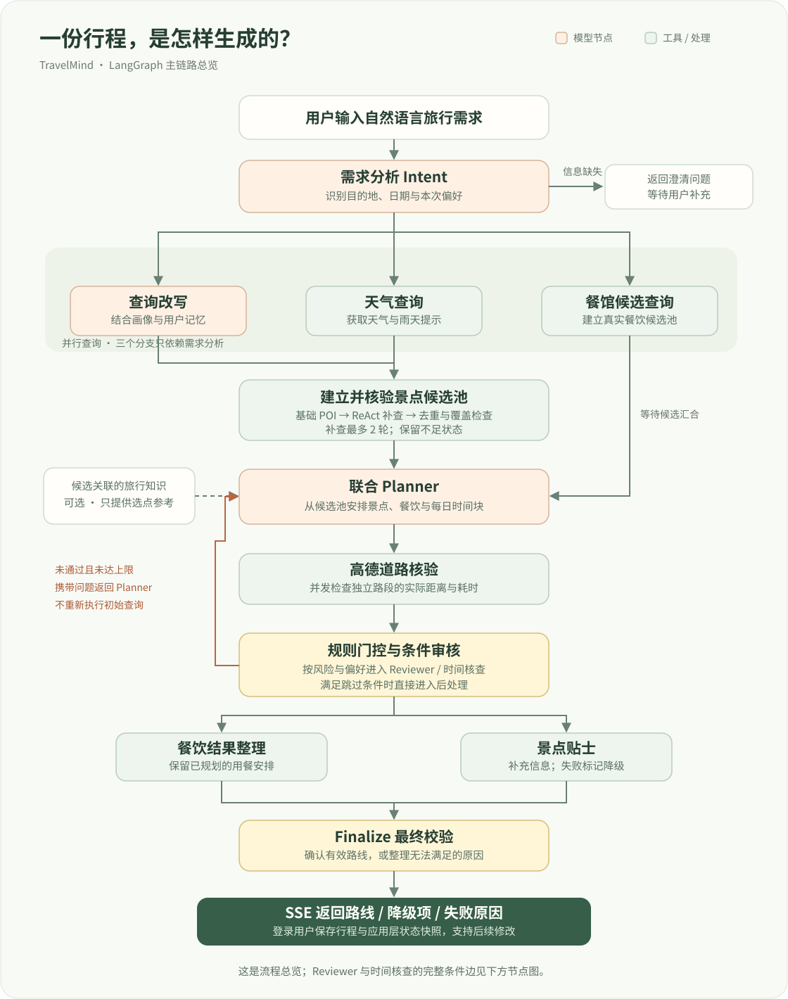
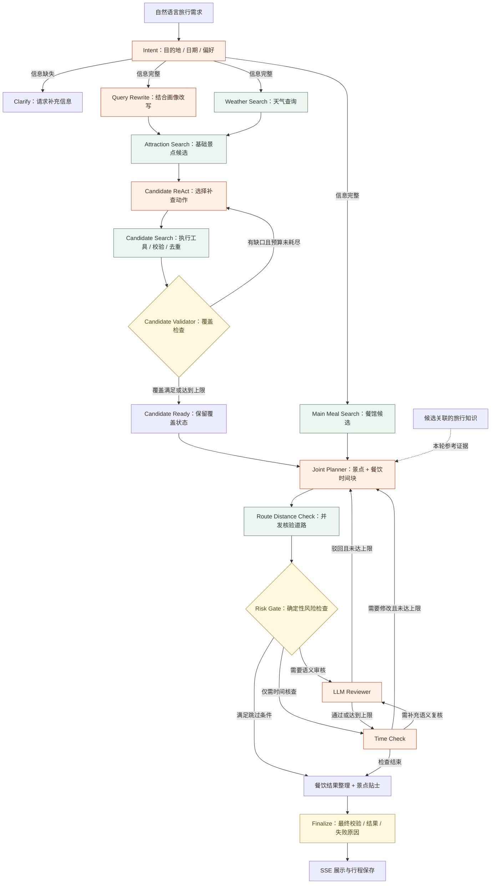
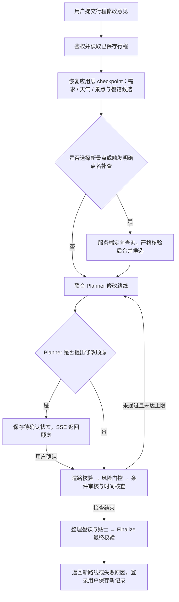

<div align="center">

# TravelMind · 途见

### 把目的地交给我，你只管期待出发。

**支持长期记忆与动态修改的 LLM 多 Agent 旅行规划应用**

[](https://github.com/yf-922/TravelMind-Agent/actions/workflows/ci.yml)


自然语言需求 → 真实景点候选 → 景点与餐饮联合规划 → 道路核验与审核 → 可修改的每日行程

[产品预览](#产品预览) · [流程总览](#核心设计) · [快速开始](#快速开始) · [评测与结果](#评测与结果) · [压测数据](#本机-http-并发压测) · [源码导航](#源码导航)

</div>


## 项目简介

TravelMind 将一句旅行需求转换为包含景点、餐饮、天气、交通与时间安排的行程。用户可以继续提出“第二天换个景点”“少走一点路”等修改意见，系统复用已保存的规划状态，再生成并检查新路线。

项目围绕旅行 Agent 的三个实际问题展开：**模型可能编造地点，生成的时间表未必可执行，修改需求容易重复查询**。地点事实来自外部工具，路线由 Planner 生成，规则与 Reviewer 分别检查可计算约束和语义质量，LangGraph 负责条件路由与有限次返工。

| 用户遇到的问题 | 项目的处理方式 |
| :--- | :--- |
| 推荐了不存在或不匹配的景点 | 先建立高德 POI 候选池，再约束 Planner 从候选中选择 |
| 到达时未开放、时间冲突、步行过长 | 规则检查时间结构，使用高德实际步行 / 驾车距离与耗时核验 |
| 形式正确，但偏好不匹配或节奏过密 | LLM Reviewer 读取用户需求、候选事实和路线，给出修改意见 |
| 修改一个景点也要重新查询所有信息 | 保存应用层 checkpoint，复用需求、天气与候选，必要时定向补查 |
| 等待时不知道系统在做什么 | SSE 返回节点进度、阶段摘要、最终结果及失败原因 |
| 每次都要重复说明喜好 | SQLite 保存结构化画像，Chroma 按用户隔离召回语义记忆 |

### 项目亮点（STAR 版）

- **S/T：** 旅行需求同时包含候选范围、开放时间、天气和步行限制，单次模型调用容易生成“看起来合理但走不通”的路线。<br>**A/R：** 用 LangGraph 编排 Intent、并行检索、Joint Planner、道路核验、Risk Gate 与有限返工，节点只通过 `TravelPlanState` 交接；把可执行性检查从提示词愿望变成可追踪的状态机约束。
- **S/T：** 城市级检索结果可能不够覆盖用户点名、室内或亲子等条件，直接让模型自由搜索会重复调用并引入池外地点。<br>**A/R：** 设计有界 `Candidate ReAct`：模型只能提出枚举动作，代码按 `query_key` 去重、校验 POI、补查缺口并受预算与轮次限制；候选池覆盖率、点名命中率和池外率均可由离线回放复核。
- **S/T：** 路线错误分为可计算的硬冲突与需要理解偏好的软问题，单一 Reviewer 难以解释错误来源。<br>**A/R：** 将开放时间、时间重叠、道路耗时、重复景点交给确定性 Risk Gate，将节奏、老人/高温等语义判断交给 LLM Reviewer，再把错误码和修改意见回流 Planner；返工次数、恢复率与各规则子项独立统计。
- **S/T：** 后训练初版首轮通过率受严格时间窗等号污染影响，B-DPO 返工挽回率还出现下降。<br>**A/R：** 审计训练轨迹定位 40 处边界脏标签、半小时网格偏置和缺失 Round-1 修复样本，清洗后补充非整点边界、道路联合约束与多轮反馈偏好；在冻结 50 场景×3 seeds 上，C-DPO 首轮可行集通过率由 B-DPO 的 71.1% 提升至 87.4%，时间窗违约由 34/135 降至 12/135。
- **S/T：** 需要证明提升来自数据与策略，而不是缓存、长度或随机波动，且 7B 模型不能可靠识别所有无解条件。<br>**A/R：** 统一生产 Prompt/Schema、`temperature=0.3`、共同 seeds、BF16 合并权重、关闭 Prefix Cache，并复用同源 Round-0 做 Planner-Only 对照；结果显示 C-DPO 闭环通过率 91.9%，同时将容量与无解判定落到前置确定性检查器兜底。

## 产品预览

**一份行程，一张地图，一条可继续修改的时间线。**


<details>
<summary><strong>展开查看：流式规划过程与用户画像</strong></summary>

**节点进度**：显示意图分析、查询、规划与审核过程。以下为仓库保存的界面截图，具体节点及轮次以当前执行为准。


**用户画像**：查看与编辑景点、饮食和出行习惯偏好。


</details>

可以从这样的请求开始：

> 南京明天出发，玩三天，喜欢历史和博物馆，想吃当地小吃，每天别安排太满，下雨优先室内。

再提出修改：

> 第二天把一个景点换成美术馆，其他安排尽量保留。

建议先注册并登录，完整体验行程保存、画像更新和后续修改。

## 核心设计

### 规划流程总览

下图展示默认 LangGraph 主链路：**并行查询 → 候选池 → 联合规划 → 道路核验与条件审核 → 最终输出**。橙色回路表示审核返工，虚线表示可选知识参考；SSE 在执行过程中持续推送进度，并在结束时返回结果。



### 01 · 用状态图管理规划过程

主链路使用 **LangGraph + Pydantic State + 条件边**。模型输出意图、行程或审核结论等结构化业务结果；代码更新状态并选择下一步，模型不能直接指定任意节点或跳过校验。

<details>
<summary><strong>展开完整节点流向：ReAct 补查、审核返工与时间复核</strong></summary>



查询改写、天气与餐馆候选依赖 Intent，可以并行启动；基础景点检索等待查询改写与天气，联合 Planner 等待景点池和餐馆池。路线核验中的独立路段也并发执行。图中“餐饮结果整理 + 景点贴士”合并展示两个并行分支，Finalize 等待两者完成。

</details>

**两种运行方式**：默认 `engine=langgraph` 使用共享 `TravelPlanState`；可选 `engine=supervisor` 使用代码主管调度、角色私有记忆和工具权限控制。两条链路共用部分生产节点，主图不依赖一个自由决定节点的 LLM Supervisor。详见 [Supervisor 运行时说明](docs/supervisor-runtime-progress.md)。

### 02 · 候选池先核验，ReAct 只补缺口

先通过城市级查询建立基础候选池，再用 `candidate_react → candidate_search → candidate_validator` 进行有界补查。模型只返回允许的搜索动作，例如室内景点或用户点名地点；实际 POI 来自高德响应。

| 保护机制 | 当前实现 |
| :--- | :--- |
| 动作范围 | Pydantic 枚举约束搜索类型，每轮最多 2 个动作 |
| 点名景点 | 查询必须来自用户明确点名；返回 POI 名称严格匹配 |
| 候选写入 | 检查名称、经纬度合法性；普通候选按评分过滤；按名称去重 |
| 重复查询 | 城市、关键词和类型生成 `query_key`，已执行查询不再调用 |
| 终止条件 | 补查最多 2 轮；基础与补查共享默认 4 次候选搜索 HTTP 尝试预算，包含重试 |
| 不足与失败 | 保留已有候选及缺口，标记 `insufficient`，交给后续规划与校验 |

缓存命中不消耗外部调用预算；上述预算仅覆盖景点候选搜索，不包括天气、餐馆和道路查询。覆盖检查涉及数量、点名命中及室内外分布；室内外标签来自类型 / 名称启发式，未知不算已满足。

代码入口：[candidate_react.py](app/planning/candidate_react.py) · [POI 适配器](app/providers/amap/poi.py)

### 03 · 硬约束与软约束分工审核

**规则处理能明确计算的问题，模型补充需要理解语义的问题。**

| 层次 | 检查内容 | 处理方式 |
| :--- | :--- | :--- |
| 规则与道路工具 | 候选越界、重复景点、时间结构、开放时间冲突、道路耗时与步行限制、餐位冲突 | 写入风险标记，供路由、返工与最终检查使用 |
| LLM Reviewer | 当前兴趣、排除偏好、游玩节奏及整体合理性 | 输出通过位、问题与修改意见；未通过时有限次回退 Planner |
| 时间核查 | 日程时间与开放窗口，需要修改时再复核 | 独立修正循环，结束后进入结果整理 |
| Finalize | 检查当前状态并整理结果 | 返回成功状态、降级项或无法完成原因 |

当前门控根据规则风险及用户偏好决定是否进入 Reviewer：**有兴趣 / 习惯要求或明确偏好表述，也会触发语义审核**，并非“硬约束没有风险就必然跳过”。主链路默认 `max_review_rounds=3`，时间核查也有独立上限。

审核发现路线问题时，主图回到 Planner 重排；审核阶段自动回到候选检索不是当前主图已实现的通用分支。候选补查主要发生在初始覆盖检查，以及修改请求中的定向核验。路线在同一候选池上仍无法满足时，由后续校验返回失败原因。

代码入口：[风险规则、Reviewer 与 Finalize](app/planning/nodes.py) · [结构化 State 与输出](app/planning/schemas.py)

### 04 · 保存状态，让修改从已有信息继续

登录用户的行程记录保存 `plan_json` 与 `planner_state_json`。修改时恢复目的地、日期、偏好、天气、景点和餐馆候选等上下文，运行修改子图，再做道路与审核检查。用户从搜索结果选择新景点时，服务端核验后才合并进入候选池。

这里的 **checkpoint 是应用保存到 SQLite 的规划状态快照**，用于行程修改与信息复用；主 LangGraph 尚未接入支持任意节点恢复的持久化 checkpointer。

Planner 重新写入当前路线；知识来源按轮覆盖，空召回不沿用旧证据；存在修改顾虑时，返回确认事件并保存待确认状态，用户确认后继续。



修改子图从 Planner 开始，复用已保存的查询事实；用户选择的新景点，以及带引号的明确点名缺口，由 API 层定向查询并核验。图中的审核阶段沿用主链路条件边，用户确认也不会绕过道路和审核检查。当前修改链路不自动重跑需求分析、天气与基础候选检索。

代码入口：[规划 API 与 checkpoint 保存](app/main.py) · [修改子图](app/planning/graph.py) · [行程存储](app/core/memory.py)

### 05 · 长期记忆与公共知识各司其职

| 存储 | 保存什么 | 用途 |
| :--- | :--- | :--- |
| SQLite · `data/app.db` | 用户账户、景点 / 饮食 / 习惯画像、历史行程、规划快照、待确认修改 | 精确读取、更新与持久化 |
| Chroma · `data/semantic_memory/` | 从用户需求提取的自然语言记忆及 `user_id` 元数据 | 语义召回；查询与删除均按用户过滤 |
| 旅行知识 · `knowledge/travel/` | 公共指引和带来源的具名景点事实卡 | 给 Planner 比较已核验候选提供参考 |
| Redis | 高频 POI 与天气查询响应 | Cache-Aside 缓存；POI TTL 12 小时，天气 TTL 4 小时 |

用户本次明确要求优先于历史偏好。主 LangGraph 的节点通过共享 State 交接信息；角色私有对话记忆属于可选 Supervisor 链路。Chroma 语义用户记忆与公共知识混合检索是两种能力。

知识检索按城市和候选实体过滤，将来源、URL 与采集日期交给 Planner；知识只能用于候选比较，不能新增候选池外地点。票价、余量与临时政策不能由历史快照当作当前事实。

检索实验独立比较关键词、BM25、向量及 RRF 混合召回，使用固定 revision 的中文 BGE；**生产 Chroma 默认 embedding 与该评测配置分开管理**。实验兴趣知识默认关闭，详见 [RAG 评测说明](docs/rag_benchmark_v2.md) 与 [最终选点对照方案](docs/route_interest_evaluation.md)。

## 快速开始

### 方式一：Docker Compose

需要 Git、Docker 与支持 `env_file.required` 的 Docker Compose v2.24+。

```bash
# 获取项目
git clone https://github.com/yf-922/TravelMind-Agent.git
cd TravelMind-Agent

# 首次配置：复制模板，并填写地图与模型 Key
cp .env.example .env.local

# 启动 FastAPI 与 Redis
docker compose up --build -d

# 查看应用日志
docker compose logs -f travelmind
```

Windows PowerShell 复制模板使用 `Copy-Item .env.example .env.local`。

| 入口 | 地址 |
| :--- | :--- |
| Web 应用 | http://127.0.0.1:8765 |
| Swagger 接口文档 | http://127.0.0.1:8765/docs |
| 依赖健康检查 | http://127.0.0.1:8765/api/health |
| Prometheus 格式指标 | http://127.0.0.1:8765/api/metrics |

Compose 通过命名卷保留应用与 Redis 数据。未配置 Key 也可以启动页面与健康检查，真实旅行规划需要高德 Web 服务 Key 和一个可用模型提供商。

**Docker 默认关闭 Chroma 能力**，避免首次启动下载 embedding 模型。开启时需同时修改 `docker-compose.yml` 中的 `SEMANTIC_MEMORY_ENABLED` 和 `TRAVEL_KNOWLEDGE_ENABLED`；仅修改 `.env.local` 不会覆盖 Compose 中的同名设置。

### 方式二：本地 Python

推荐 Python 3.11 或 3.12。前端由应用直接提供，基本运行无需另行执行 npm 构建。

```powershell
# Windows PowerShell
git clone https://github.com/yf-922/TravelMind-Agent.git
cd TravelMind-Agent
py -3.11 -m venv .venv
.\.venv\Scripts\Activate.ps1
python -m pip install -r requirements.txt
Copy-Item .env.example .env.local

# 编辑 .env.local 后启动
python run.py
```

<details>
<summary><strong>Linux / macOS 启动命令</strong></summary>

```bash
git clone https://github.com/yf-922/TravelMind-Agent.git
cd TravelMind-Agent
python3.11 -m venv .venv
source .venv/bin/activate
python -m pip install -r requirements.txt
cp .env.example .env.local
# 填写环境变量后启动
python run.py
```

</details>

### 最小配置与可选能力

下面使用 DeepSeek 提供商；模型名称请与账户当前可访问的模型保持一致。

```dotenv
# 高德 Web 服务 Key：后端 POI、天气与道路查询
AMAP_API_KEY=your_amap_web_service_key

# 高德 JS API Key 与安全密钥：前端地图展示
AMAP_JS_KEY=your_amap_js_key
AMAP_JS_SECURITY_CODE=your_amap_js_security_code

# 选择一个模型提供商；支持 deepseek / openai / grok / doubao
LLM_PROVIDER=deepseek
DEEPSEEK_API_KEY=your_deepseek_key
# DEEPSEEK_MODEL=your_available_model

# 本地 Redis 可选；不使用缓存时留空
REDIS_URL=

# 普通运行按节点超时；关闭整单 180 秒截止
# 模板原值为 180，复制后请按需要修改
PLAN_TIMEOUT_SECONDS=0

# 先运行基础链路，再按需开启语义能力
SEMANTIC_MEMORY_ENABLED=0
TRAVEL_KNOWLEDGE_ENABLED=0
TRAVEL_INTEREST_KNOWLEDGE_ENABLED=0
```

其他提供商的字段见 [.env.example](.env.example) 和 [LLM 接入说明](LLM_PROVIDERS.md)。环境变量、数据库、运行时索引及账本在 `data/` 或 `.env.local` 中，不提交到仓库。

## 流式交互与可观测性

SSE 负责**服务端到前端**的进度推送，Agent 之间通过 State 或结构化消息传递信息。规划第一帧包含 `run_id`，响应头包含 `X-Request-ID` 与 `X-Agent-Run-ID`。

| 事件 / 接口 | 作用 |
| :--- | :--- |
| `run` / `stage` / `stage_summary` | 标识执行、当前节点及阶段摘要 |
| `modification_warning` | 返回修改顾虑，等待用户确认 |
| `result` | 返回最终成功状态、路线或失败信息 |
| `GET /api/agent-runs/{run_id}` | 登录用户查看自己的节点耗时、降级项和 LLM 用量摘要 |
| `GET /api/metrics` | HTTP 时延、节点统计、LLM 调用、输入 / 输出 Token 与 usage 精确率 |

默认节点期限：Planner 150 秒、Intent 90 秒、查询改写与 ReAct 决策 60 秒、天气 15 秒，其余 120 秒。可用 `NODE_TIMEOUT_SECONDS` 或 `NODE_TIMEOUT_PLANNER_SECONDS` 等覆盖。整单应急上限由 `PLAN_TIMEOUT_SECONDS` 控制；代码默认关闭，但环境模板填写了 180 秒，部署时需显式选择。

Token 统计区分供应商实际 usage 与字符估算；只有配置单价后成本估算才有意义。执行 Trace 保留最近 200 次，位于进程内存，不保存原始 Prompt、模型思考与完整回复。SSE 尚不提供基于 event ID 的断线重放。

<details>
<summary><strong>接口调用示例：注册并发起流式规划</strong></summary>

以下为 Bash 示例，依赖 `curl` 和 Python。注册用户名应使用未占用的名称，密码自行设置。

```bash
# 注册返回 token；已有账号可改用 /api/auth/login
TRAVELMIND_TOKEN=$(curl -fsS http://127.0.0.1:8765/api/auth/register \
  -H 'Content-Type: application/json' \
  -d '{"username":"travelmind-demo","password":"replace-with-your-password"}' \
  | python -c 'import sys,json; print(json.load(sys.stdin)["token"])')

# -N 禁止 curl 缓冲，实时显示 SSE 数据
curl -N http://127.0.0.1:8765/api/plan/stream \
  -H "Authorization: Bearer $TRAVELMIND_TOKEN" \
  -H 'Content-Type: application/json' \
  -d '{"query":"南京明天出发三日游，喜欢历史和博物馆，慢节奏","engine":"langgraph","max_review_rounds":3}'
```

修改请求在相同接口传入 `plan_id` 与 `modification_notes`。个人画像、历史行程、景点搜索与路线编辑的完整 schema 可在本地 Swagger 查看。

</details>

## 评测与结果

### 已复现的工程验证

2026-10-23，本地 Python 3.12.8 全量回归：**520 项 pytest 通过**（约 25 秒，3 条依赖弃用警告），另有 **5 项 SSE 客户端测试通过**；Python 编译与三项评测资产校验均完成。测试覆盖结构化输出、调度、候选边界、记忆隔离、修改链路、风险检查、SSE 结果处理、评测账本和降级契约。GitHub Actions 配置同类检查，具体远程执行状态以上方 CI 徽章为准。

### 本机 HTTP 并发压测

**2026-10-20 实测 8,100 次请求**：真实 TCP 请求进入独立 Uvicorn 单进程，经 FastAPI 和临时 SQLite 返回。使用 50 个合成用户、1,000 条历史行程；画像和历史接口同时检查返回数据归属，健康检查验证数据库状态。测试不读取个人数据库，不调用模型或地图。

三个接口分别测试并发 **1 / 8 / 32**，每档 **300 请求 × 3 次重复**，每次另预热 12 请求。以下展示并发 8 的合并结果，P95 及吞吐均包含失败请求；本轮未出现失败。

| 接口 | 请求数 | 吞吐 req/s | P50 | P95 | 失败 |
| :--- | ---: | ---: | ---: | ---: | ---: |
| 健康检查 `/api/health` | 900 | 1,595.74 | 3.818 ms | 10.463 ms | 0 |
| 用户画像 `/api/profile` | 900 | 1,125.28 | 5.271 ms | 17.285 ms | 0 |
| 历史行程 `/api/history` | 900 | 797.94 | 9.700 ms | 14.020 ms | 0 |

**并发增加不等于吞吐持续增加**：并发 32 时，画像接口 P95 升至 **105.489 ms**，吞吐降至 **796.46 req/s**；历史接口 P95 升至 **62.811 ms**。本轮结果支持继续排查高并发排队、数据库与连接开销，尚未定位具体瓶颈。

这是同机客户端的闭环读接口测试，不包含 LLM 规划、SSE 长连接、外部 API、持续写入或多实例部署，不能据此估算旅行规划容量。完整 9 档结果、三次重复、逐请求耗时、错误和源码指纹见 [HTTP 压测报告](evaluation/http_load_20261020.md) / [原始 JSON](evaluation/http_load_20261020.json)。

### 规划节点并行基准

使用生产状态图 / 道路核验节点，将外部操作替换为固定延迟的离线实现；与相同工作量的串行执行比较，每项重复 **30 次**。该实验用于验证调度效果。

| 对照 | 固定工作量 | 串行 P50 | 并行 P50 | P50 加速比 |
| :--- | :--- | ---: | ---: | ---: |
| 查询改写、天气、餐馆候选 | 3 分支，各 40 ms | 132.684 ms | 50.707 ms | **2.62×** |
| 餐饮结果、景点贴士 | 2 分支，各 40 ms | 88.900 ms | 48.519 ms | **1.83×** |
| 道路距离核验 | 8 路段，各 20 ms | 164.498 ms | 25.275 ms | **6.51×** |

checkpoint 已移除阶段等待与固定 Token 预算模拟，改为读取 **30 份保存的真实模型初稿状态**，调用生产节点构造完整重跑和局部修改 Prompt。使用 `tiktoken cl100k_base` 对实际 Prompt 文本分词，本轮完整路径 **73,858**、局部路径 **51,941**，减少 **29.7%**；每次局部修改跳过 **2 个前置 LLM 节点**及天气、POI 两类查询。这里统计的是 Prompt 文本，不含工具 Schema 和协议开销，也不是 Grok 账单 Token；没有外部等待 Trace，不报告端到端耗时收益。

完整 P50 / P95、逐次配对数据、环境与源码指纹见 [工程基准报告](evaluation/offline_engineering_benchmark.md) / [原始 JSON](evaluation/offline_engineering_benchmark.json)。30 份状态各重复 3 次；本地耗时只包含状态序列化、恢复和 Prompt 构建。真实模型的质量与用量另见下面的配对消融。

### 真实模型配对消融

最新 Reviewer 消融使用 **60 个自建场景、3 组、180 个记录结果**：30 个任务场景与 30 个鲁棒性场景。共享真实模型生成的首轮联合 Planner 草案，使用相同候选与回放；规则组和 Reviewer 组均允许最多 3 次返工，并移除 Time Check 以隔离 Reviewer 作用。

| 指标 | 仅 Planner | 规则 + 返工 | 规则 + Reviewer + 返工 |
| :--- | ---: | ---: | ---: |
| 任务成功 | 26/30 | 30/30 | 30/30 |
| 任务错误放行 | 4/30 | 0/30 | 0/30 |
| 鲁棒性成功或明确拒绝 | 14/30 | 18/30 | 20/30 |
| 实际恢复 | 14/30 | 15/30 | 15/30 |
| 有原因的安全拒绝 | 0/30 | 3/30 | 5/30 |

**结论**：完整审核闭环较仅规划的任务成功率提高 **13.3 个百分点**，本批提升主要来自规则与返工；Reviewer 没有进一步提高普通任务通过数。它在“必须安排不存在景点”的请求中识别出无解条件，拒绝把替代路线当作满足请求。

这是实际生产规划 / 审核节点的受控实验：上游候选与道路响应使用固定回放，评分为预设代码 rubric，不能当作人工审查结论或完整线上服务成功率。Reviewer 组仍有 9/30 鲁棒性错误放行，道路证据缺失是下一项重点。

<details>
<summary><strong>查看资源开销与复现边界</strong></summary>

实验使用 `grok-4.6`，实际付费尝试 196 次，记录输入 428,869、输出 195,661 Token；超时调用用量未知，费用为 `unpriced`。各组资源归因将共享草案计入每组逻辑开销，不能相加当作实际账单。

| 组别 | 记录的逻辑 Token | 平均实测耗时 |
| :--- | ---: | ---: |
| 仅 Planner | 276,655 | 36.3 秒 |
| 规则 + 返工 | 324,014 | 42.6 秒 |
| 规则 + Reviewer + 返工 | 573,825 | 69.9 秒 |

耗时包含天气变化 / 修改场景的共享前置草案；一条未恢复耗时的共享失败不参与均值。详细实验与逐项失败解释见 [Reviewer 消融报告](docs/reviewer_ablation_v2.md)。旧版 [任务与鲁棒性报告](docs/task_robustness_real_v1.md) 保留评分资产缺陷和原始失败，不覆盖为新版结果。

### Reviewer 软约束挑战（待人工复核）

在不改变原始账本的前提下，新增 4 个可满足的语义缺陷（老人登阶、38°C 正午暴晒、排斥商业主题、跨区折返）、1 个不可满足对照和 1 个正常对照。三组共用人工注入的初始草案，最多 3 轮返工；组合结果是 **25 条历史自然草案 + 5 条受控挑战**，不能改称新的 30 条自然请求成功率：Planner-only **21/30**、Rules **25/30**、Rules + Reviewer **29/30**；4 个可满足缺陷的修复为 **0/4、0/4、4/4**。原 6 条标签已由用户确认；另新增两条不可满足冲突用例，标签均为 `verified_v2`，并用确定性回放验证三轮返工后安全拒绝。它们没有新增真实模型消融结果；原不可满足模型对照曾发生 1 次 Reviewer 结构化解析失败，安全兜底结果已在逐案报告中单列。

当前风险门控回放基于 30 个保存的真实初稿：30/30 进入语义 Reviewer，跳过率 **0%**；历史账本没有 Time Check 或自适应 A/B 的完整用量，因此不再把旧的 61.8% 当作当前实测节省。详见[当前门控审计](evaluation/adaptive_routing_replay.md)、[软约束人工复核材料](evaluation/soft_review_v3.md)、[不可满足安全用例补充](evaluation/soft_review_v3_safety_addendum.md)和[评测协议](docs/evidence_benchmark_protocol_v3.md)。

</details>

### RAG：分别检验召回与最终选点

| 评测 | 资产 / 结果 | 当前状态 |
| :--- | :--- | :--- |
| 旧检索契约集 | 30 条查询：24 条可回答、6 条无答案；关键词与混合均命中 24/24，Top-1 分别 24/24、23/24 | 未显示混合检索优势；旧 `Recall@3` 实为来源 Hit@3 的别名 |
| 六城检索评测 v2 | 128 个语料块、120 条草稿查询，开发 / 测试各 60；关键词、BM25、向量及 3 种融合对照 | 工具与资产就绪；正式报告要求人工标注、来源确认和冻结 |
| 最终路线选点对照 | 南京、上海、三亚 30 个案例，相同候选池对比有 / 无知识 | 用最终选点而非说明文字衡量收益，正式结论仍需冻结评测 |

128 块含 **28 块项目规划建议**，不全部是官方事实。v2 区分 Recall、Hit、MRR、nDCG、Precision、事实覆盖、失败率与可用率；融合失败不会偷偷降级为关键词成功。BGE 固定 revision、语料和配置指纹参与索引及冻结验证。

目前检索增强仍保留实验开关，尚未完成支持其生产收益的正式冻结报告。混合检索是否优于单路，需要由相同数据与明确标注的实验结果决定。

详见 [早期检索报告](docs/rag_test_report.md) · [v2 协议](docs/rag_benchmark_v2.md) · [实施记录](docs/rag_benchmark_v2_implementation_report.md) · [最终路线对照](docs/route_interest_evaluation.md)。

## 📊 后训练优化与受控消融评测 (Post-Training & Controlled Ablation)

### 1. 实验背景与严格受控评测协议 (Evaluation Protocol)

本项目对核心 `Joint Planner` 做了四代数据与后训练迭代：`Base → v2 → A/B → C`。目标是提高候选池封闭域忠实度、开放时间与道路转场约束遵守，以及规则反馈后的局部重排能力。

- **评测集与解码**：冻结 50 个场景（45 个可行、5 个不可行）× 3 个共同 seed（1001/1002/1003），每个模型 150 次运行；统一生产 `Joint Planner` 提示词、`TravelRoute` Schema、`temperature=0.3`、`top_p=0.95`。
- **双模式同源对比**：`Planner-Only` 直接取同一条 `Rules+Rework` 轨迹的 Round 0；`Rules+Rework` 使用冻结确定性 Rubric 错误码反馈，最多额外返工 3 轮，不调用外部 Reviewer API。
- **推理环境隔离**：模型均合并为完整 BF16 权重，通过本地流式 vLLM 顺序加载；关闭 Prefix Cache、并发为 1，每个模型先做 5 条预热并丢弃。统一记录输出长度、TTFT 和 `TPOT P50`（本地约 17.4 ms/token）。单卡顺序加载不能保证不同模型处于同一物理时刻，因此延迟只作服务级参考。
- **统计口径**：可行集通过率以 45 个可行场景 × 3 次生成为分母；5 个不可行场景单独统计识别率、合规拒答率和幻觉率。3 个 seed 是重复生成，不是独立训练实验。

### 2. 四代九模型演进与核心结果总表 (Main Results)

下表中的本地模型结果来自同一受控协议。`Rules+Rework` 列是返工后的最终可行集通过率；“闭环 Planner Token”是可行集上该模式所有 Planner 调用的累计 Token。教师模型使用同一冻结集和本地规则评分，但其 Planner 运行在外部 API 上。

| 模型 | Planner-Only 可行集通过率 | Rules+Rework 可行集通过率 | 首轮 `user_time_window` 违约 /135 | 可行集返工挽回率 | All-3-Pass | 闭环 Planner Token | 可行集 P50/P95 延迟 |
|---|---:|---:|---:|---:|---:|---:|---:|
| Base | 49.6% | 50.4% | — | 1.5% | 44.4% | 1,118,242 | 12.5s / 32.4s |
| v2-SFT | 64.4% | 70.4% | — | 16.7% | 64.4% | 877,632 | 7.5s / 23.6s |
| v2-DPO | 61.5% | 69.6% | — | 21.2% | 64.4% | 893,378 | 7.7s / 24.3s |
| A-SFT | 39.3% | 46.7% | — | 12.2% | 28.9% | 1,208,416 | 17.0s / 30.3s |
| A-DPO | 43.0% | 48.9% | — | 10.4% | 33.3% | 1,174,965 | 18.2s / 31.2s |
| B-SFT | 68.1% | 78.5% | 35 | 32.6% | 68.9% | 807,237 | 7.4s / 24.2s |
| B-DPO | 71.1% | 76.3% | 34 | 17.9% | 71.1% | 790,063 | 7.2s / 23.9s |
| **C-SFT** | **83.7%** | **91.9%** | **15** | **50.0%** | **88.9%** | **598,329** | **6.6s / 22.5s** |
| **C-DPO** | **87.4%** | **91.9%** | **12** | **35.3%** | **91.1%** | **560,897** | **6.6s / 22.4s** |
| GPT-6.1-sol JSON-mode | 91.1% | 100.0% | — | 100.0% | 100.0% | 1,164,037 | 16.7s / 36.4s |

教师模型延迟包含外部网络、供应商排队与调度，不与本地 vLLM 延迟直接混比；教师模型的输入较长，Token 口径也由供应商返回。早期非同协议教师基准不并入本表。

教师 JSON-mode 结果的不可行集识别率和合规拒答率均为 100%，本地 C-SFT/C-DPO 在当前冻结集上均为 0% 合规拒答率；该差异是当前最明确的剩余能力缺口。

### 3. Data-Centric 迭代归因与关键工程发现 (Key Findings & Ablation Insights)

- **历史脏标签清洗与时间窗突破（B → C）**：静态审计定位到 40 处“严格晚于/早于”边界等号污染，以及 91.2% 的 `:00/:30` 半小时网格偏置。清洗旧数据并补充非整点边界后，首轮 `user_time_window` 违约从 B-DPO 的 34/135 降至 C-DPO 的 12/135，下降 64.7%；C-DPO 可行集首轮通过率达到 87.4%，接近教师模型的 91.1%。C-DPO Planner-Only 平均输出约 334 tokens，教师约 537 tokens；Token 不能直接等同为成本，因为两者供应商和提示长度不同。
- **单轮 DPO 返工坍缩与多轮修复对齐**：B-DPO 使用的偏好对主要是 Round 0 单轮样本，首轮通过率提升到 71.1%，但返工挽回率由 B-SFT 的 32.6% 降至 17.9%。C 版加入 20 条带规则反馈的 Round 1 修复轨迹及单缺陷扰动负例后，C-DPO 返工挽回率恢复到 35.3%，C-SFT 为 50.0%；两者闭环通过率均为 91.9%，C-DPO 闭环 Planner Token 相比 Base 可行集累计值下降约 49.8%。
- **反向消融警示（A 系列）**：A 系列在当前协议下首轮仅 39.3%（A-SFT）和 43.0%（A-DPO）。其道路与时间轴联合约束失败更多，返工触发率和闭环 Token 上升，说明数据分布、长度压缩与候选事实对齐比单纯增加训练步骤更关键。
- **C 的提升是组合效果**：C 同时包含历史标签清洗、非整点边界样本、开放/道路联合约束和多轮修复样本；当前实验不能把提升分别归因到某一项改动。

### 4. 现存局限性与混合架构落地结论 (Limitations & Production Architecture)

- **不可行场景的捷径学习与反馈鸿沟**：当前 5 道不可行题实际上是同一类冲突：每题有 20 个候选，但用户窗口只有 60 分钟，必游单点要求连续 90 分钟。本地微调模型合规拒答率为 0%，教师模型为 100%。静态审计发现，训练集 60 条空路线样本全部集中在 1–3 个候选点的小池子里，模型可能把“拒答”与“小候选池”虚假绑定；本地无解分支 Early Return 只返回抽象英文错误码，缺少“可用 60 分钟 < 要求 90 分钟”的算术证据。
- **不可行识别率不是充分指标**：本地评分器的关键词识别率存在假阳性，例如“无法据此推断通勤”可能命中“无法”和“90/分钟”等词；必须以“空 `spots`、完整天数结构、准确冲突原因”同时满足作为合规拒答。
- **评测边界**：这 50 题已用于诊断和数据迭代，虽与训练 Prompt 指纹不交集，但不应再称完全盲测。当前闭环是“生产 Planner + 本地规则反馈”，不等同于线上语义 Reviewer 闭环；评测器增加过可选教师 API 后端，核心判分、返工和聚合逻辑已审计保持一致。
- **生产落地建议**：`C-DPO` 适合作为本地 7B 主力 `Joint Planner`，负责可行路线的高效生成和局部规则返工；硬性容量、开放窗口、道路可行性和无解判断交由前置确定性可行性检查器（Pre-flight Deterministic Checker）兜底拦截。不要把端到端无解拒答完全交给 7B 模型。

相关证据与资产：

- 受控九模型报告：[controlled_9_model_ablation_report.md](data/post_train/online_holdout50_20261027_v2/controlled-7arm-localrules-20261028/controlled_9_model_ablation_report.md)
- 教师 JSON-mode 对照：[summary.json](data/post_train/online_holdout50_20261027_v2/teacher-api-localrules-20261028-jsonmode/teacher-gpt-6.1-sol/summary.json)
- C 版冻结训练集：[c_sft_train.json](data/post_train/c_release_20261028_training/c_sft_train.json) · [c_dpo_train.json](data/post_train/c_release_20261028_training/c_dpo_train.json)
- 受控评测脚本：[evaluate_controlled_online_holdout.py](scripts/evaluate_controlled_online_holdout.py)

## 测试与复现

以下检查不需要真实 LLM 或高德调用。

```bash
# 安装测试与检索评测依赖
python -m pip install -r requirements-dev.txt -r requirements-rag-eval.txt

# 与 CI 一致的基本检查
python -m compileall -q app tests scripts
python scripts/validate_eval_assets.py
python scripts/validate_rag_assets.py --corpus knowledge/benchmark_v2_curated/chunks.json --cases evaluation/rag_benchmark_v2_draft.json --require-quota
python scripts/review_route_interest.py validate
python -m pytest -q
node --test scripts/test_sse_client.cjs

# 本机 HTTP 压测：独立服务进程与临时 SQLite，约 8,100 次实测请求
python scripts/benchmark_http.py --requests 300 --concurrency 1 8 32 --warmups 12 --repetitions 3

# 调度基准：固定外部延迟，每组 30 次，输出 JSON 与 Markdown
python scripts/offline_engineering_benchmark.py --runs 30 --route-legs 8 --fanout-delay-ms 40 --provider-delay-ms 20 --stage-unit-delay-ms 2

# 有界候选检索的六场景契约检查
python scripts/evaluate_candidate_react.py

# 独立 Supervisor 演示：离线工具，不需要 API Key
python -m app.multi_agent_core.demo_run --offline --city Beijing --request "Plan a relaxed cultural day trip"
```

<details>
<summary><strong>展开查看：离线消融、检索开发实验与真实评测入口</strong></summary>

**历史结构消融**：39 条人工构造案例，9/39 → 26/39 → 35/39 是离线结构契约成绩，不是最近真实模型消融的结果。

```bash
python -m tests.eval.ablation --json evaluation/ablation_report.json --out evaluation/ablation_report.md
```

**真实节点评测预检**：不加 `--execute` 时不调用真实模型，生成运行记录到被忽略的 `data/`。

```bash
python scripts/evaluate_task_robustness.py --out data/eval/task_robustness_offline.json
python scripts/evaluate_reviewer_ablation.py
```

**RAG 开发实验**：先显式下载固定 BGE，再运行开发集。该命令使用待审标签，只产生探索性报告；模型下载需要网络和本地存储，查询阶段不会下载模型。

```bash
python scripts/prepare_rag_embedding.py --download
python scripts/sweep_rag_v2.py --cases evaluation/rag_benchmark_v2_draft.json --corpus knowledge/benchmark_v2_curated/chunks.json --out data/rag_v2_dev_draft.json
```

人工审核与冻结命令见 [v2 协议](docs/rag_benchmark_v2.md)。真实模型 / 地图运行须使用相应入口的显式授权开关及调用上限，执行前查看其 `--help`；缺失实际 Token、费用或执行结果的字段保留未知。原始运行账本、逐请求输出与本地索引保存在 `data/`，不提交。

</details>

## 源码导航

| 层次 | 技术 / 设计 | 入口 |
| :--- | :--- | :--- |
| Agent 编排 | LangGraph、条件边、有限循环、Pydantic 结构化输出 | [graph.py](app/planning/graph.py)、[schemas.py](app/planning/schemas.py) |
| 规划与审核 | 联合 Planner、规则门控、Reviewer、Time Check | [nodes.py](app/planning/nodes.py) |
| 工具检索 | 高德 POI、天气、步行 / 驾车路径 | [providers](app/providers)、[candidate_react.py](app/planning/candidate_react.py) |
| 用户记忆 | SQLite 画像 / 行程、Chroma 用户过滤 | [memory.py](app/core/memory.py)、[semantic_memory.py](app/core/semantic_memory.py) |
| 公共知识 / RAG | 候选实体过滤、关键词 / 向量、独立 BM25 + BGE 评测 | [travel_knowledge.py](app/core/travel_knowledge.py)、[rag_retrieval.py](app/evaluation/rag_retrieval.py) |
| 服务与交互 | FastAPI、SSE、React / JSX、高德 JS API | [main.py](app/main.py)、[frontend](frontend) |
| 可靠性与观测 | Redis、节点超时、Trace、Token / 延迟指标 | [agent_runs.py](app/core/agent_runs.py)、[cache.py](app/core/cache.py) |
| 实验协作引擎 | Supervisor、私有角色记忆、工具白名单、本地消息契约 | [multi_agent_core](app/multi_agent_core) |
| 部署与验证 | Docker Compose、pytest、GitHub Actions | [Compose](docker-compose.yml)、[CI](.github/workflows/ci.yml) |

```text
TravelMind-Agent/
├── app/
│   ├── planning/           # 主状态图、候选 ReAct、联合规划与审核
│   ├── multi_agent_core/   # 可选 Supervisor 与私有记忆协作引擎
│   ├── providers/          # 地图、天气、票务等外部适配器
│   ├── core/               # 用户记忆、缓存、鉴权、指标与执行 Trace
│   ├── evaluation/         # 检索协议、路线评分与故障评测
│   ├── llm/                # 提供商适配、结构化调用与模型路由
│   └── api/                # 用户、画像、历史与路线编辑接口
├── frontend/               # 页面、地图、时间线与 SSE 客户端
├── static/images/          # 项目界面截图
├── knowledge/              # 旅行知识、来源快照与版本化评测语料
├── evaluation/             # 版本化评测资产和可公开报告
├── tests/                  # 单测、集成测试、契约及评测 Fixture
├── scripts/                # 采集、校验、评测、账本与报告工具
├── docs/                   # 架构、实验设计和进展说明
└── data/                   # 本地数据库 / 索引 / 账本；Git 忽略
```

## 常见问题

<details>
<summary><strong>页面能打开，但规划不能运行？</strong></summary>

检查 `.env.local` 中的 `LLM_PROVIDER` 与对应 Key 是否匹配，高德 Key 是否为 Web 服务类型，模型名是否可用。地图展示另需 JS API Key 与安全密钥；它们与后端 Web 服务 Key 不通用。查看 `docker compose logs -f travelmind` 或本地终端的错误码。

</details>

<details>
<summary><strong>规划超过 180 秒就停止？</strong></summary>

`.env.example` 中填写了 `PLAN_TIMEOUT_SECONDS=180`。改为 `0` 并重启应用，即使用节点级期限；保留正值则启用整单应急上限。某节点超时会返回 `NODE_TIMEOUT` 与节点名，不能靠其他分支持续进度刷新它的期限。

</details>

<details>
<summary><strong>Chroma 或 Redis 不可用，是否完全不能规划？</strong></summary>

Redis 不可用时跳过缓存；Chroma 用户记忆返回 `skipped/degraded` 状态，仍可使用当前需求与 SQLite 画像。知识检索失败不能沿用旧证据。模型、候选或道路等核心依赖的失败会影响结果，具体状态由最终检查决定。

</details>

<details>
<summary><strong>这里的 checkpoint 能从任意节点崩溃恢复吗？</strong></summary>

当前应用快照用于已保存行程的修改，并未实现主 LangGraph 任意节点的持久化恢复。Trace 也位于进程内存。生产多实例部署前需要另行设计持久化执行状态、会话并发控制和断线恢复。

</details>

<details>
<summary><strong>MCP / A2A 是已部署的协议服务吗？</strong></summary>

目前是本地 `AgentCard`、工具 manifest 与任务 envelope 契约，用于演示能力发现、权限与消息结构。它们不是已部署的远程 MCP Server 或 A2A 网络服务。

</details>

## 文档与后续方向

- [部署与观测](docs/production-readiness.md)：健康检查、Token、节点指标和降级。
- [Supervisor 运行时](docs/supervisor-runtime-progress.md)：私有记忆、角色隔离与协作链路。
- [Reviewer 真实消融](docs/reviewer_ablation_v2.md)：对照方式、资源和失败归因。
- [RAG 评测协议](docs/rag_benchmark_v2.md)：语料、标注、冻结、指标公式与对照配置。
- [最终路线兴趣评测](docs/route_interest_evaluation.md)：只用实际选点验证知识是否有效。

下一阶段优先补齐道路证据缺失时的最终放行策略、候选问题的审核回检索路由、正式人工标注与冻结检索对照，以及持久化执行恢复。生产默认配置随证据调整，保留每版报告与失败案例。

## 项目来源与致谢

本项目基于 [FloatTrip](https://github.com/shouzhuoshouzhuo/FloatTrip) 开展课程与个人工程实践。原项目提供基础界面与旅行规划能力；本仓库重点扩展有界候选搜索、审核与返工、状态复用、道路核验、用户记忆、协作引擎及评测工具。具体改动以 [提交记录](https://github.com/yf-922/TravelMind-Agent/commits) 为准。

感谢 LangGraph、FastAPI、Chroma 及其他开源依赖。使用地图与模型服务时遵守各提供商条款；贡献代码前请移除真实密钥、用户数据和运行账本。

---

<div align="center">

**让每一步规划都有依据，让每一次修改都能继续。**

[查看源码](https://github.com/yf-922/TravelMind-Agent) · [反馈问题](https://github.com/yf-922/TravelMind-Agent/issues) · [查看 CI](https://github.com/yf-922/TravelMind-Agent/actions)

</div>
